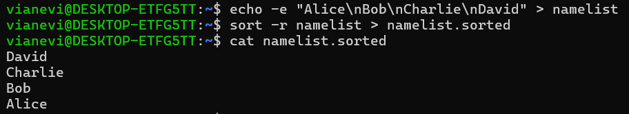

### 1. Create `namelist` and add names:

echo -e "Alice\nBob\nCharlie\nDavid" > namelist

### 2. Sort in reverse order and save to namelist.sorted:

sort -r namelist > namelist.sorted

### 3. Check the result:

cat namelist.sorted

**Output:**

David \
Charlie \
Bob \
Alice

## All the commands in terminal:

