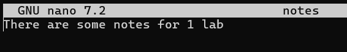
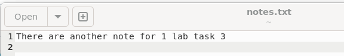
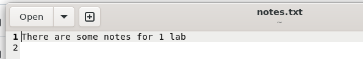
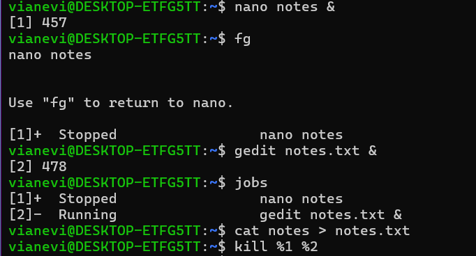

### 1. Create `notes` using nano and open it in the background:

```
nano notes &
```

### 2. Bring it to the foreground, write some notes, save the change, and send it again to the background:

```
fg
```



### 3. Open a new file `notes.txt` using gedit in the background, write something and save the change:

```
gedit notes.txt &
```



### 4. Print the status of job list:

```
jobs
```

**Output:**

```
[1]+  Stopped                 nano notes
[2]-  Running                 gedit notes.txt &
```

### 5. Redirect the output of file `notes` to the file `notes.txt`:

```
cat notes > notes.txt
```

### 6. Return to the gedit:



### 7. Stop both processes:

```
kill %1 %2
```


## All the commands in terminal:


