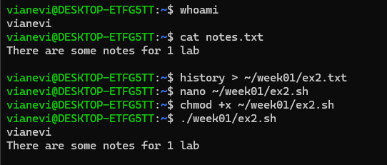

### 1. Save command history to `~week01/ex2.txt`:

```
history > ~/week01/ex2.txt
```

### 2. Store the commands in a script `ex2.sh`:

```
nano ~/week01/ex2.sh
```

### 3. Make script executable and run it:

```
chmod +x ~/week01/ex2.sh
./week01/ex2.sh
```

## All the commands in terminal:


