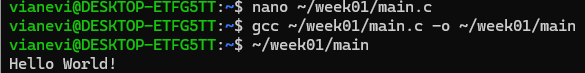

### 1. Create `~/week01/main.c` and write program for printing "Hello World!":

```
nano ~/week01/main.c
```

### 2. Compile and run:

```
gcc ~/week01/main.c -o ~/week01/main
~/week01/main
```

**Output:**

```
Hello World!
```

## All the commands in terminal:


